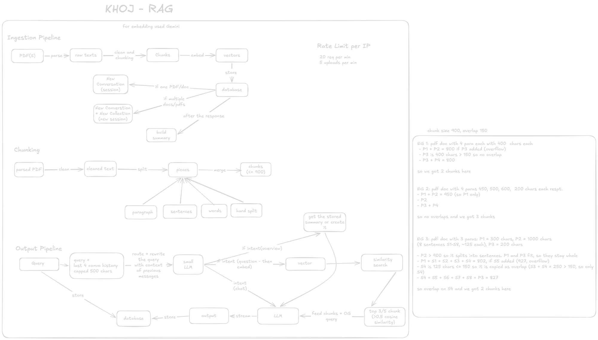

# Khoj docs

Khoj lets you upload documents and chat with them. Ask a question, and the answer comes only from what is in your files.

It is a basic RAG (retrieve, then read) with query rewriting: cut documents into chunks, turn each chunk into a vector, and when a question arrives, rewrite it using the chat history, find the closest chunks and hand only those to an LLM.

## Guides

Each guide explains one part of the diagram, with small examples.

| Guide | Covers | Code |
|---|---|---|
| [Chunking](chunking.md) | How extracted text is cut into chunks (size, overlap, where cuts land) | `lib/chunker.ts` |
| [Ingestion](ingestion.md) | Upload, extract, embed, store, sessions and collections | `lib/ingest.ts`, `app/api/upload/route.ts` |
| [Retrieval and answering](retrieval-and-answering.md) | Routing (question, overview, chat), similarity search, summaries, streaming, history | `app/api/chat/route.ts` |
| [Database](database.md) | Tables, the `match_chunks` search function, access rules, deletes ([schema.sql](schema.sql)) | `docs/schema.sql` |

## Key numbers

| What | Value | Where |
|---|---|---|
| Chunk size / overlap | 900 / 150 chars | `lib/chunker.ts` |
| Smallest chunk kept | over 20 chars | `lib/chunker.ts` |
| Embedding model | `gemini-embedding-001`, 768 dimensions, 50 chunks per request | `lib/gemini.ts` |
| Chunks sent to the LLM | top 3 (one document), top 5 (collection) | `app/api/chat/route.ts` |
| Similarity cutoff | cosine similarity of at least 0.5 | `app/api/chat/route.ts` |
| History given to the answer LLM | last 10 messages, read from the database | `app/api/chat/route.ts` |
| Router (intent + query rewrite) | last 4 messages, 500 chars each, model `openai/gpt-oss-20b` | `app/api/chat/route.ts` |
| Document summary | built after upload by `qwen/qwen3.8-27b`, 24,000 chars per call, under 400 words | `lib/summary.ts` |
| Overview fallback | 8 closest chunks, no cutoff (only if no summary can be built) | `app/api/chat/route.ts` |
| Answer model | `qwen/qwen3.8-27b` (Groq) | `app/api/chat/route.ts` |
| Upload limits | 3 files per upload, 20 MB per file | `lib/files.ts` |
| Rate limits | chat 20/min, upload 5/min, per IP | `lib/rate-limit.ts` |
