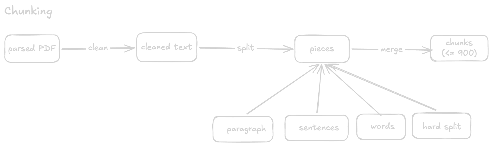

# Chunking

Code: `lib/chunker.ts`. Settings: **chunk size 900 chars, overlap 150 chars.**



The diagram shows the order of cuts. It leaves out the 150-character overlap between chunks and the dropping of chunks of 20 characters or fewer, both covered below.

## Why chunk at all

The LLM cannot read a whole PDF for every question. So the text is cut into small pieces called **chunks** (think index cards). Each chunk is turned into a vector and stored. When you ask something, the search finds the best few chunks, and only those go to the LLM.

A chunk is useful only if it holds a complete thought. Take this text and the question "What is the cancellation fee for enterprise customers?":

> Refunds take 7 days. Enterprise customers must call sales. Their cancellation fee is 10%.

Cutting every N characters, regardless of content, can give:

```
Card 1: "Refunds take 7 days. Enterprise customers mus"
Card 2: "t call sales. Their cancellation fee is 10%."
```

Card 1 knows "Enterprise" but not the fee. Card 2 has the fee but not who it is for. Neither answers the question. Cutting only between sentences, and repeating the previous sentence at the start of the next card, fixes it:

```
Card 1: "Refunds take 7 days. Enterprise customers must call sales."
Card 2: "Enterprise customers must call sales. Their cancellation fee is 10%."
```

## How it works

```
parsed text -> clean -> split into pieces -> merge into chunks -> drop tiny chunks -> embed
```

### 1. Clean

- A single line break becomes a space. PDFs break lines mid-sentence, so `"jumps over\nthe dog"` becomes `"jumps over the dog"`.
- A blank line is kept. It marks a paragraph break.
- Null bytes, control characters and repeated spaces are removed.

### 2. Split into pieces

Cut the text at the biggest natural break that makes pieces fit in 900 chars. Try the breaks in this order, and move to the next only for pieces that are still too big:

| Order | Break | Looks like |
|---|---|---|
| 1 | Paragraph | blank line |
| 2 | Sentence | `. ` `? ` `! ` |
| 3 | Word | a space |
| 4 | Hard cut | every 900 chars (only if a single "word" is over 900) |

A paragraph of 900 chars or less stays whole as one piece. A bigger paragraph is split into sentence pieces.

### 3. Merge into chunks

Go through the pieces in order and add them to the current chunk until the next piece would push it over 900. Then close the chunk and start a new one.

**Overlap:** the new chunk starts with a copy of the last piece or pieces of the previous chunk, but only if together they are 150 chars or less. That copy counts toward the new chunk's 900. If the last piece is longer than 150, nothing is copied.

Overlap is a safety copy. A thought sitting at a chunk edge then appears whole in at least one chunk. It is not there to fill up the size.

### 4. Drop tiny chunks

Chunks of 20 chars or fewer are thrown away.

## Examples

Chunk size 900, overlap 150. (Sizes are approximate: the blank line between paragraphs adds 2 chars, so "800" is really 802.)

**EG 1:** a PDF with 4 paragraphs of 400 chars each.
- P1 + P2 = 800. Adding P3 would overflow, so close chunk 1.
- The last piece of chunk 1 is P2 (400 chars), more than 150, so no overlap.
- P3 + P4 = 800.
- Result: **2 chunks**, no overlap.

**EG 2:** a PDF with 4 paragraphs of 450, 500, 600 and 200 chars.
- P1 + P2 = 950, over 900, so chunk 1 is P1 only.
- P2 + P3 = 1100, over 900, so chunk 2 is P2 only.
- P3 + P4 = 800.
- Result: **3 chunks**, no overlap (P1 and P2 are over 150, so neither can be copied).

**EG 3:** a PDF with 3 paragraphs: P1 = 300 chars, P2 = 1000 chars (8 sentences S1 to S8, about 125 each), P3 = 200 chars.
- P2 is over 900, so it splits into sentences. P1 and P3 fit, so they stay whole.
- P1 + S1 + S2 + S3 + S4 = 802. Adding S5 would give 927, so close chunk 1.
- S4 is 125 chars, 150 or less, so it is copied as overlap. S3 + S4 is 250, over 150, so only S4.
- S4 + S5 + S6 + S7 + S8 + P3 = 827.
- Result: **2 chunks**, overlap on S4.

```
chunk 1: [P1] [S1] [S2] [S3] [S4]
chunk 2:                    [S4] [S5] [S6] [S7] [S8] [P3]
                             ^ overlap
```

## Things to know

- Sentences are not one chunk each. Sentences are only pieces. They are packed together, roughly 6 to 8 per chunk.
- Short paragraphs share chunks. A chunk does not care about paragraph edges.
- Old documents keep their old chunks. Changing the chunker affects new uploads only. Re-upload a document to re-chunk it.
- Changing the numbers. `CHUNK_SIZE` and `OVERLAP` are at the top of `lib/chunker.ts`. After a change, the similarity cutoff (0.5, in `lib/agent-tools.ts`) may need retuning, because bigger chunks shift similarity scores.
- No page numbers yet. Chunks do not record which PDF page they came from.
