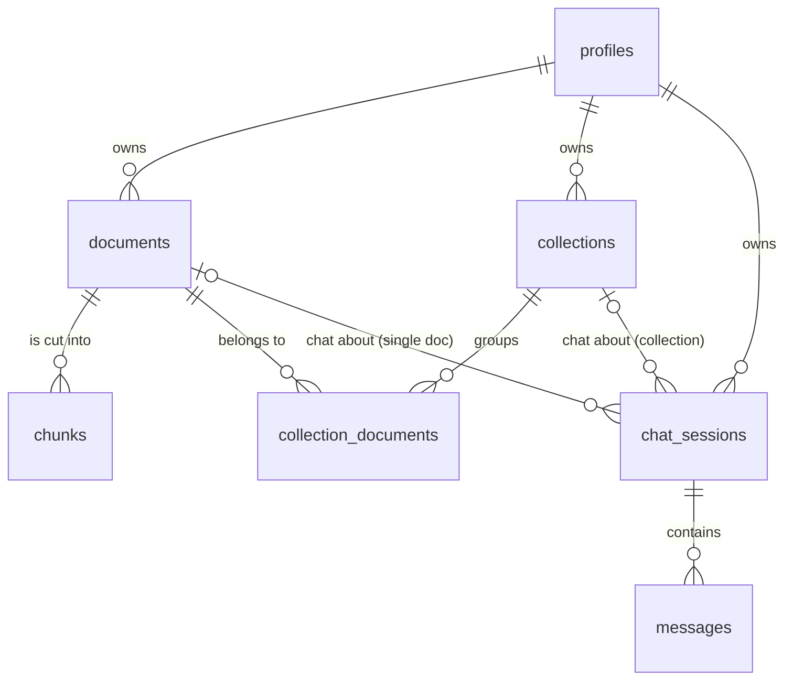

# Database

Supabase Postgres with the `pgvector` extension (v0.8.0). The full SQL is in [schema.sql](schema.sql).

`schema.sql` was rebuilt from the live database's catalog, not exported with `pg_dump`, and has not been run on an empty database. Treat it as the best written record of the schema, and check it before using it to rebuild.

## The tables



| Table | One row is | Key columns |
|---|---|---|
| `profiles` | a signed-in user (created automatically by the `on_auth_user_created` trigger on `auth.users`) | `id` (same as the auth user id), `email`, `name`, `avatar_url` |
| `documents` | an uploaded file | `title`, `file_name`, `status`, `page_count`, `chunk_count`, `summary`, `pinned`, owner |
| `chunks` | one ~900-char slice of a document | `document_id`, `content`, `chunk_index`, `embedding` |
| `collections` | a group of 2 to 3 documents | `title`, `pinned`, owner |
| `collection_documents` | a link between a collection and a document | `collection_id`, `document_id` |
| `chat_sessions` | a conversation | `document_id` **or** `collection_id`, `title`, owner |
| `messages` | one chat message | `session_id`, `role`, `content`, `source_chunks`, `tokens_used` |

**Owner** means one of two columns. `user_id` is set for signed-in users. `session_token` is set for guests, and it is a random id kept in the browser. Exactly one is filled in.

## Example: what one upload leaves behind

A signed-in user uploads `handbook.pdf` (12 pages), then asks one question.

```
documents   id=d1  title="handbook"  status="ready"  page_count=12  chunk_count=40  user_id=u1
            summary="- Employee handbook for ... " (filled in shortly after the upload)
chunks      40 rows: (document_id=d1, chunk_index=0..39, content="...", embedding=[768 numbers])
chat_sessions  id=s1  document_id=d1  collection_id=NULL  user_id=u1
messages    (session_id=s1, role="user",      content="How long do refunds take?")
            (session_id=s1, role="assistant", content="5 to 7 business days.",
             source_chunks=[{id, content, similarity}, ...], tokens_used=412)
```

If the user had uploaded three files, there would be three `documents`, their chunks, one `collections` row, three `collection_documents` rows, and one `chat_sessions` row with `collection_id` set and `document_id` empty.

## The search function: `match_chunks`

Called from `app/api/chat/route.ts` with a question vector. It returns the closest chunks.

```sql
match_chunks(query_embedding, match_document_id, match_collection_id, match_count)
```

- **Which chunks to search:** if `match_collection_id` is given, all chunks of every document in that collection. Otherwise, only chunks of `match_document_id`.
- **How closeness is measured:** `<=>` is cosine **distance** (0 = identical meaning). The function returns `similarity = 1 - distance`, so 1 is the same meaning and values near 0 are unrelated.
- **How many:** the closest `match_count` chunks, best first. The route asks for 3 for a document and 5 for a collection, then drops anything under 0.5 (see [Retrieval and answering](retrieval-and-answering.md)).

Example, with the question "How long do refunds take?" in `handbook.pdf`:

```
id  chunk_index  similarity  content
17  12           0.71        "Refunds take 5 to 7 business days to appear."
16  11           0.64        "To request a refund, email support..."
 4  3            0.52        "Refunds are allowed within 30 days of purchase."
```

The index on `chunks.embedding` is `ivfflat` with `vector_cosine_ops` and `lists = 100`, which matches the `<=>` operator.

## Security: who can see what

Two layers, and they work differently.

**Row level security (RLS) is on for every table.** Each policy says a row is visible if it belongs to the signed-in user (`user_id = auth.uid()`), or if its `session_token` equals the `x-session-token` header the request carries. Child tables (`chunks`, `messages`, `collection_documents`) inherit through their parent.

The browser sends that header on every request (`lib/supabase/client.ts`), using the token from `localStorage`. So the browser can read only its own documents, chats and messages.

**The server bypasses RLS.** The API routes use the service-role key (`lib/supabase/admin.ts`), which ignores every policy. So on the server, access control is only what the code checks:

- `DELETE` and `PATCH` on documents and collections check `user_id` in code, and need a signed-in user.
- `POST /api/chat` checks ownership before it does anything. A session with a `user_id` needs that signed-in user. A guest session needs the matching `khoj_session_token` cookie. Anything else gets the same "Session not found" (404) as a missing session, so ids cannot be probed.

When a guest signs in, `app/auth/callback/route.ts` moves their documents, collections and sessions to their account (it sets `user_id` and clears `session_token`), so old guest chats keep working.

## What gets deleted with what

Foreign keys cascade, so deleting a parent removes its children. The one exception is a collection: the delete route removes its documents explicitly, because the database does not.

| Delete | Also removed |
|---|---|
| a document | its chunks, its collection links, its chat sessions and their messages, and the file in Storage |
| a collection | its links, its chat sessions and their messages, **and every document in it** (with chunks) |
| a user (`auth.users`) | their profile, and through it their documents, collections and sessions |

Deleting a collection removes its documents' rows but **not their files in Storage**. Only the single-document delete removes the file, so collection deletes leave orphaned files in the `documents` bucket.

## Storage

Bucket `documents` holds the original uploads. It is **private**, and allows only PDF, TXT, MD and DOCX. There is no size limit on the bucket; the 20 MB limit is enforced by the app. Files are stored at `<user_id>/<timestamp>-<name>`, or `guest/<token>/<timestamp>-<name>` for guests.

`documents.file_url` is not a working link, because the bucket is private. It is only used to work out the storage path when deleting.

## Things to know

- **Search is approximate.** An `ivfflat` index looks at only a slice of the data, then applies the "this document only" filter afterwards. With little data, Postgres will usually ignore the index and compare everything, which is exact. With a lot of data, results can miss chunks or come back fewer than asked. If that happens, look at an `hnsw` index or turning on iterative scans.
- **Missing indexes.** Only primary keys and the vector index exist. There is no index on `chunks.document_id`, `messages.session_id`, `chat_sessions.document_id` or `collection_id`, or the `user_id` columns. Fine for now, slow later, including for cascading deletes.
- **Two versions of `match_chunks`.** The live database still has an older 3-argument version, `(query_embedding, match_document_id, match_count)`, which the app does not use. Only the 4-argument version is in `schema.sql`. To remove the old one:
  ```sql
  drop function public.match_chunks(vector, uuid, integer);
  ```
- **A session should point at exactly one thing.** Nothing in the database stops a `chat_sessions` row from having both `document_id` and `collection_id`, or neither. The upload route sets exactly one.
- **Summaries cover at most the first 1000 chunks.** `lib/summary.ts` reads a document's chunks in one query, and Supabase returns at most 1000 rows by default. Past that (about 750,000 characters), the summary leaves out the end of the document.
