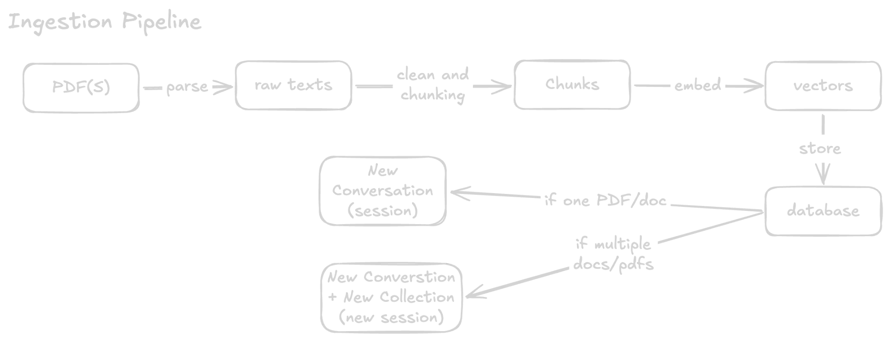

# Ingestion

What happens between "user drops a file" and "ready to chat".

Code: `app/api/upload/route.ts` (the request) and `lib/ingest.ts` (one file).



## The flow in one line

```
file -> parse to text -> clean and chunk -> embed each chunk -> store -> open a conversation
```

## Before anything is stored

The upload request is checked first, so a bad file cannot leave a half-finished upload behind:

- At most **3 files** per upload.
- At most **20 MB** per file.
- Supported types: **PDF, TXT, MD, DOCX**.
- At most **5 uploads per minute** per IP.

Every file is checked before the first one is processed. If the third file is a `.zip`, nothing is stored.

## Step by step

### 1. Parse: file to raw text

Each file type has its own reader (`lib/extractor.ts`):

| Type | How the text is read |
|---|---|
| PDF | `pdf-parse`. Also gives the page count. |
| DOCX | `mammoth` (raw text, no formatting). |
| TXT / MD | Read as plain text. Markdown symbols (`#`, `**`, links) are stripped so chunks read as plain sentences. |

If no text comes out (for example a scanned PDF that is only images), the file fails with "Could not extract any text". There is no OCR.

### 2. Clean and chunk: raw text to chunks

The text is cleaned and cut into chunks of about 900 characters. See [Chunking](chunking.md) for how.

### 3. Embed: chunks to vectors

Each chunk is sent to Gemini (`gemini-embedding-001`), which returns a **vector**: a list of 768 numbers that captures the meaning of the text. Chunks that mean similar things get similar numbers.

A simplified picture, with 2 numbers instead of 768:

```
"refund policy"      -> [0.90, 0.10]
"money back rules"   -> [0.85, 0.15]    close to the one above: similar meaning
"pizza recipe"       -> [0.10, 0.95]    far away: unrelated
```

Chunks are sent in batches of 50 with a 200 ms pause between batches. Chunks are marked as `RETRIEVAL_DOCUMENT`; questions are later marked `RETRIEVAL_QUERY`. Gemini tunes the vector for each side, so the two must not be swapped.

### 4. Store: save to the database

For each file, three things are saved (Supabase):

| Where | What |
|---|---|
| Storage bucket `documents` | The original file. |
| `documents` table | One row: title, file name, status, page count, chunk count. |
| `chunks` table | One row per chunk: the text, its position (`chunk_index`) and its vector (`embedding`). |

The raw upload, the `documents` row and the text extraction run **at the same time**, since none depends on the others.

The document's `status` shows where it is:

```
processing  ->  ready      (chunks saved)
            ->  error      (no text found, or chunking, embedding or saving chunks failed)
```

The `error` state exists so a failed file does not sit on "processing" forever. It does not catch every failure, see "Things to know".

### 5. Open a conversation

After ingestion, a chat session is created. What it points at depends on how many files were uploaded:

| Files | What is created | Chat searches in |
|---|---|---|
| 1 | a `chat_sessions` row with `document_id` | that document only |
| 2 to 3 | a `collections` row, links in `collection_documents`, and a `chat_sessions` row with `collection_id` | all documents in the collection |

The collection is titled after the first file, for example `report + 2 more`. Files are processed one after another. Each is linked to the collection as soon as it finishes, so if the third file fails, the first two stay in the collection instead of disappearing.

## Example

A signed-in user uploads `handbook.pdf` (12 pages).

1. The checks pass. The upload is one file, under 20 MB.
2. 12 pages give about 30,000 characters of text.
3. Chunking gives roughly 40 chunks (a new chunk starts about every 750 chars, since 150 are overlap).
4. Embedding: 40 chunks fit in one request of 50.
5. Saved: the PDF in Storage, 1 `documents` row (`status = ready`, `page_count = 12`, `chunk_count = 40`), and 40 `chunks` rows with vectors.
6. One `chat_sessions` row is created, and the user lands in the chat.

If the user had uploaded `handbook.pdf` + `policy.pdf` + `faq.docx`, the same happens three times, then one collection links the three documents and one session covers all of them.

## Who owns the data

- **Signed in:** rows get your `user_id`.
- **Guest:** rows get a `session_token` kept in the browser, and files are stored under `guest/<token>/`. Clear the browser and you lose access to them.

## Things to know

- **Some failures leave the row on "processing".** If the file upload to Storage fails, or the text extraction itself throws (for example a corrupt PDF), the `documents` row has already been created and is never moved to `error`. Only failures after extraction are marked.
- **Slow for big files.** Everything happens inside one request. A very large PDF can hit server time limits.
- **Chunks do not know their page.** Only the total page count is saved.
- **Same file twice = stored twice.** There is no duplicate check.
- **Old documents keep old chunks.** Changing the chunker only affects new uploads.
