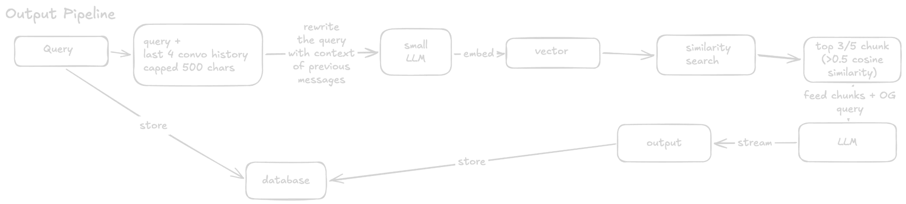

# Retrieval and answering

What happens between "user presses Send" and "the answer finishes streaming".

Code: `app/api/chat/route.ts`. Embedding: `lib/gemini.ts`.



## The flow in one line

```
question -> rewrite with history -> embed -> find similar chunks -> ask the LLM with those chunks -> stream the answer -> save
```

## Step by step

### 0. Checks and history

- Chat is limited to **20 requests per minute** per IP.
- The session says what to search: one document or one collection.
- The session must belong to the caller. A signed-in user's session needs that user. A guest's session needs the matching guest cookie. Otherwise the reply is "Session not found" (404), the same as for a session that does not exist.
- The **last 10 messages** of the conversation are loaded **from the database**, not from the browser. This happens before the new question is saved, so the question is not in its own history.
- The user's question is saved to `messages`.

### 1. Rewrite the question (small LLM)

Search works on the meaning of the text. A follow-up like "and the second one?" means nothing alone. So a small, fast LLM (`openai/gpt-oss-20b`) rewrites it into a standalone question, using the **last 4 messages**, each cut to **500 characters**.

```
History:
  User:      What are the three plans?
  Assistant: Basic ($5/mo), Pro ($15/mo) and Team ($40/mo).
New question: and the second one?

Rewritten for search: Pro ($15/mo)
```

- A question that already stands alone comes back unchanged.
- **First message of a conversation:** there is no history, so the rewrite is skipped.
- **If the rewrite call fails,** the original question is used. A rewrite problem never blocks an answer.
- The rewrite is used **only for searching.** The answer LLM later gets your original wording.

### 2. Embed

The rewritten question is turned into a vector by Gemini, marked `RETRIEVAL_QUERY`. It is the same kind of 768-number vector the chunks have (see [Ingestion](ingestion.md)).

### 3. Similarity search

The `match_chunks` function in Supabase compares the question vector with the chunk vectors and returns the closest ones, with a **cosine similarity** score from 0 to 1 (1 means the same meaning, near 0 means unrelated). The SQL is in [schema.sql](schema.sql), explained in [Database](database.md).

- It only looks inside the current **document or collection**.
- It returns the **top 3** chunks for a single document, or the **top 5** for a collection.
- Then chunks scoring **below 0.5 are thrown away.**

Example scores for the question "How long do refunds take?" in one document:

```
0.71  "Refunds take 5 to 7 business days to appear."     kept
0.64  "To request a refund, email support..."             kept
0.52  "Refunds are allowed within 30 days of purchase."   kept
0.48  "Our office is open Monday to Friday."              dropped (top 3 was already full)
```

Three chunks go forward. A question about something not in the document might score `0.31, 0.28, 0.22`: all below 0.5, so nothing goes forward.

### 4. No match: stop here

If no chunk reaches 0.5, the LLM is **not called.** The reply is a fixed message, saved and streamed like a normal answer:

> I couldn't find that information in the document.

This saves a call and stops the model from making something up.

### 5. Ask the LLM

The answer model (`qwen/qwen3.8-27b`, on Groq) gets:

1. **A system prompt:** answer strictly from the context, say "couldn't find" if it is not there, do not invent anything.
2. **The kept chunks,** labelled `[Chunk 1]`, `[Chunk 2]`, and so on.
3. **The last 10 messages** of history.
4. **The user's original question** (not the rewritten one).

```
system:  You answer only from this context.
         [Chunk 1]: Refunds take 5 to 7 business days to appear.
         [Chunk 2]: To request a refund, email support...
history: (previous messages)
user:    And what if I don't get one?
```

The original wording goes here because the LLM also sees the history and can read "it" and "that" itself. The rewrite exists only to help the search.

### 6. Stream and save

The answer arrives token by token over server-sent events:

1. First a `sources` event with the chunks used, so the page can show them while the text is still typing.
2. Then `token` events, one per piece of text.
3. Then `done`.

When the stream ends, the answer is saved to `messages` with its source chunks and the tokens used. If the stream breaks halfway, the part that arrived is still saved. A partial answer is better than an empty turn.

## Things to know

- **Summaries often fail.** "Summarize this document" matches no single chunk well, so it can score under 0.5 and return the "couldn't find" message.
- **The 0.5 cutoff is fixed.** It was picked by hand. If answers are missing too often, or wrong chunks get through, it is the first number to tune (`SIMILARITY_THRESHOLD`).
- **Top-k first, cutoff second.** A chunk ranked 4th is never considered, even if it scores above 0.5.
- **Old "couldn't find" replies stay in history.** They are included like any other message.
- **Max answer length is 2048 tokens**, at temperature 0.3.
